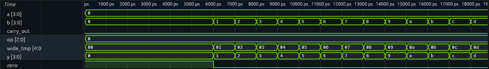

# Parameterized ALU

**What it is:** A parameterized combinational arithmetic and logic unit (`alu`) in Verilog.

**Why it matters:** Clean arithmetic and logic blocks are core building blocks for digital control and mixed-signal support circuits.

## Interface

| Port | Direction | Width | Description |
| :--- | :--- | :--- | :--- |
| `a` | `input` | `WIDTH` | First operand |
| `b` | `input` | `WIDTH` | Second operand |
| `op` | `input` | `3` | Operation select (`0`: ADD, `1`: SUB, `2`: AND, `3`: OR, `4`: XOR, `5`: SLL, `6`: SRL, `7`: SLT) |
| `y` | `output` | `WIDTH` | Result |
| `carry_out` | `output` | `1` | Carry/borrow bit from `WIDTH+1` add/sub |
| `zero` | `output` | `1` | High (`1`) when `y` is zero |

## Design

* Parameterized width (`WIDTH`) in a latch-free combinational `case` block.
* Computes `carry_out` on add/sub and `zero` when `y == 0`.

## Verification

* Lint-clean with `verilator --lint-only -Wall` (`make lint`).
* Self-checking testbench (`make test`) covering all $N=4$ combinations and 1,000 fixed-seed random vectors at $N=8$.

## Results

* Prints `TEST PASSED` with 0 errors.

## Limitations and next steps

* Unclocked combinational block; `b[1:0]` sets shift count.
* Next: clean build files, push to GitHub with green CI, and build `counter`, `tick_gen`, `debouncer`, and `pwm`.