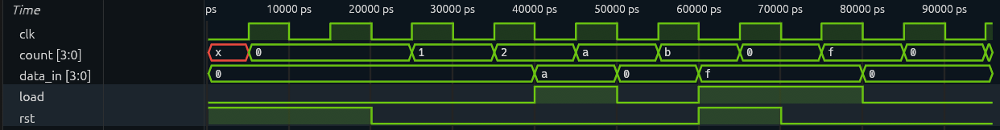

# Parameterized Counter

**What it is:** A parameterized synchronous counter (`counter`) with synchronous reset and parallel load in Verilog.

**Why it matters:** Reliable clocked counters are core building blocks for timing, sequencing, control paths, and mixed-signal support circuits.

## Interface

| Port | Direction | Width | Description |
| :--- | :---: | :---: | :--- |
| `clk` | `input` | `1` | Clock input (active on rising edge) |
| `rst` | `input` | `1` | Synchronous active-high reset (`count` resets to `0`) |
| `load` | `input` | `1` | Synchronous parallel load enable (when `rst` is low) |
| `data_in` | `input` | `WIDTH` | Parallel load value |
| `count` | `output` | `WIDTH` | Registered count output |

## Design

- Parameterized width (`WIDTH`, default `4`) clocked on `posedge clk` using non-blocking assignments.
- Priority order on rising clock edge: synchronous `rst` (`0`), then `load` (`data_in`), then increment by `1` with natural `WIDTH`-bit wrap-around.

## Verification

- Lint-clean with `verilator --lint-only -Wall` (`make lint`).
- Self-checking testbench (`make test`) verifying reset, parallel load, reset priority over load, and wrap-around from max value (`4'hF` to `4'h0`).

## Results

- Prints `TEST PASSED` with 0 errors.

## Limitations and next steps

- Fixed increment-by-one up-counter with parallel load; no down-count, count-enable, or configurable modulo limit yet.
- Next: save `docs/waveform.png`, clean build files (`make clean`), verify CI on `main`, and build `tick_gen`.