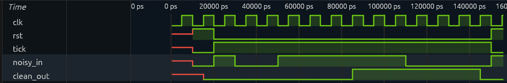

# Parameterized Debouncer

**What it is:** A parameterized tick-driven switch debouncer (`debouncer`) with a two-flip-flop input synchronizer in Verilog.

**Why it matters:** Mechanical switches and buttons bounce across multiple cycles; debouncing prevents false triggers in control logic, counters, and user interfaces.

## Interface

| Port | Direction | Width | Description |
| :--- | :---: | :---: | :--- |
| `clk` | `input` | `1` | Clock input (active on rising edge) |
| `rst` | `input` | `1` | Synchronous active-high reset (`clean_out` and internal state clear to `0`) |
| `tick` | `input` | `1` | Sample enable strobe (typically from `tick_gen`) |
| `noisy_in` | `input` | `1` | Raw asynchronous switch/button input |
| `clean_out` | `output` | `1` | Debounced output level |

## Design

- Synchronizes `noisy_in` through a two-stage flip-flop chain (`sync_0`, `sync_1`) on `posedge clk`.
- Evaluates stability on `tick` strobes using `STABLE_TICKS` consecutive matching samples before updating `clean_out`, resetting the stability counter if the signal bounces back.

## Verification

- Lint-clean with `verilator --lint-only -Wall` (`make lint`).
- Self-checking testbench (`make test`) covering bounce rejection, sustained high/low settling, and synchronous reset.

## Results

- Prints `TEST PASSED` with 0 errors.

## Limitations and next steps

- Outputs a debounced level (`clean_out`) rather than a separate single-cycle rising/falling edge pulse; requires an external `tick` strobe source.
- Next: save `docs/waveform.png`, run `make clean`, add the module to `SUBDIRS`, verify CI, and build `pwm`.