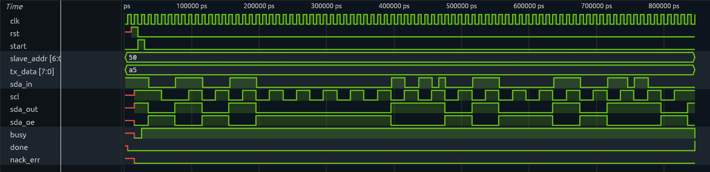

# Single-Byte I2C Master

**What it is:** A parameterized single-byte write I2C master (`i2c_master`) with open-drain-style `sda_oe`/`sda_out`/`sda_in` control, ACK checking, and `START`/`STOP` framing in Verilog.

**Why it matters:** I2C is a widely used two-wire bus for EEPROMs, RTCs, PMICs, and sensors, contrasting nicely with full-duplex SPI and asynchronous UART.

## Interface

| Port | Direction | Width | Description |
| :--- | :---: | :---: | :--- |
| `clk` | `input` | `1` | System clock input (active on rising edge) |
| `rst` | `input` | `1` | Synchronous active-high reset (`scl=1`, `sda_oe=0`, `busy=0`, `done=0`) |
| `start` | `input` | `1` | Initiates a single-byte write transaction when idle |
| `slave_addr` | `input` | `7` | 7-bit target peripheral address (MSB first) |
| `tx_data` | `input` | `8` | 8-bit data payload written after address ACK |
| `sda_in` | `input` | `1` | Sampled SDA line input |
| `scl` | `output` | `1` | Generated I2C serial clock |
| `sda_out` | `output` | `1` | Driven SDA value when `sda_oe` is high |
| `sda_oe` | `output` | `1` | Output enable for open-drain `0` drive (`0` releases line to pull-up `1`) |
| `busy` | `output` | `1` | High (`1`) while a transaction is active |
| `done` | `output` | `1` | Single-cycle pulse (`1`) when STOP completes |
| `nack_err` | `output` | `1` | High (`1`) if a NACK (`sda_in != 0`) is seen on address or data ACK |

## Design

- Synchronous FSM clocked on `posedge clk` using `CLK_DIV` to step `scl` low and high phases.
- Drives open-drain low (`sda_oe=1, sda_out=0`) for `0` bits and releases (`sda_oe=0`) for `1` bits and ACK phases, checking `sda_in` during ACK high intervals.

## Verification

- Lint-clean with `verilator --lint-only -Wall` (`make lint`).
- Self-checking testbench (`make test`) verifying reset, `START`, 7-bit address + write bit, slave ACK handling, 8-bit data transfer, and `STOP` completion.

## Results

- Prints `TEST PASSED` with 0 errors.

## Limitations and next steps

- Single-byte write only (no multi-byte burst, read transactions, clock stretching, or multi-master arbitration yet).
- Next: save `docs/waveform.png`, run `make clean`, add `i2c_master` to root `Makefile` `SUBDIRS`, and verify full CI pass.