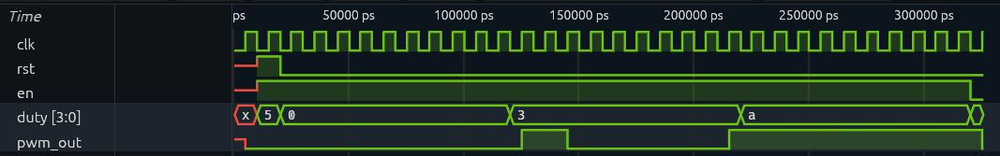

# Parameterized PWM

**What it is:** A parameterized pulse-width modulator (`pwm`) with programmable period and duty cycle in Verilog.

**Why it matters:** Pulse-width modulation is a foundational output block for LED dimming, motor control, power conversion, and analog-like actuation from digital logic.

## Interface

| Port | Direction | Width | Description |
| :--- | :---: | :---: | :--- |
| `clk` | `input` | `1` | Clock input (active on rising edge) |
| `rst` | `input` | `1` | Synchronous active-high reset (clears counter, shadow duty, and `pwm_out` to `0`) |
| `en` | `input` | `1` | Enable input (advances period counter and drives `pwm_out` when high) |
| `duty` | `input` | `WIDTH` | Desired high-time count within each `PERIOD` |
| `pwm_out` | `output` | `1` | Registered pulse-width modulated output |

## Design

- Parameterized width (`WIDTH`) and period (`PERIOD`) clocked on `posedge clk` using non-blocking assignments.
- Samples `duty` at period start (`cnt == 0`) into a shadow register (`duty_q`) and compares against the next counter state so `0%` and `100%` duty boundaries stay glitch-free.

## Verification

- Lint-clean with `verilator --lint-only -Wall` (`make lint`).
- Self-checking testbench (`make test`) verifying reset, `0%`, `30%`, and `100%` duty cycles, and enable gating.

## Results

- Prints `TEST PASSED` with 0 errors.

## Limitations and next steps

- Edge-aligned single-channel PWM with fixed compile-time `PERIOD`; no dead-time insertion, center-alignment, or runtime prescaler yet.
- Next: save `docs/waveform.png`, run `make clean`, add `pwm` to root `Makefile` `SUBDIRS`, and verify full CI pass.