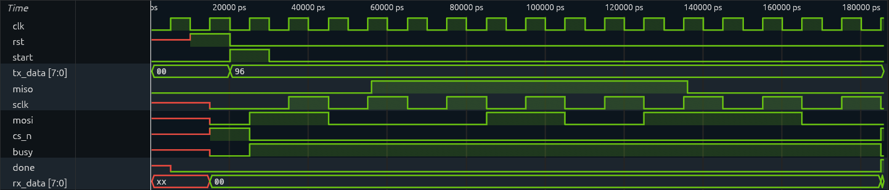

# Parameterized SPI Master

**What it is:** A parameterized full-duplex SPI master (`spi_master`) with configurable data width and clock divider in Verilog.

**Why it matters:** SPI is a core synchronous serial bus for ADCs, flash memory, displays, sensors, and board-level peripherals.

## Interface

| Port | Direction | Width | Description |
| :--- | :---: | :---: | :--- |
| `clk` | `input` | `1` | System clock input (active on rising edge) |
| `rst` | `input` | `1` | Synchronous active-high reset (`cs_n=1`, `sclk=0`, `busy=0`, `done=0`) |
| `start` | `input` | `1` | Starts an SPI transfer when idle (`!busy`) |
| `tx_data` | `input` | `DATA_WIDTH` | Parallel transmit word shifted out MSB-first on `mosi` |
| `miso` | `input` | `1` | Serial input sampled from peripheral |
| `sclk` | `output` | `1` | Generated SPI serial clock |
| `mosi` | `output` | `1` | Master-out slave-in serial data output |
| `cs_n` | `output` | `1` | Active-low chip select (`0` during transfer, `1` when idle) |
| `busy` | `output` | `1` | High (`1`) while a transfer is in progress |
| `done` | `output` | `1` | Single-cycle pulse (`1`) when a transfer completes |
| `rx_data` | `output` | `DATA_WIDTH` | Captured parallel word received on `miso` |

## Design

- Parameterized `DATA_WIDTH` and `CLK_DIV` clocked synchronously on `posedge clk` using non-blocking assignments.
- Asserts `cs_n` low on `start`, toggles `sclk` in half-periods set by `CLK_DIV`, shifts `tx_data` MSB-first on `mosi`, samples `miso` into `rx_data`, and asserts `done` upon completion.

## Verification

- Lint-clean with `verilator --lint-only -Wall` (`make lint`).
- Self-checking testbench (`make test`) verifying reset, MSB-first `mosi` shift-out (`8'h96`), `miso` capture (`8'h3C`), and `cs_n`/`busy` return to idle.

## Results

- Prints `TEST PASSED` with 0 errors.

## Limitations and next steps

- Single master lane with idle-low `sclk` and fixed `CLK_DIV`; multi-slave `cs_n` decoding, configurable CPOL/CPHA modes, or FIFO buffering can be layered on top.
- Next: save `docs/waveform.png`, run `make clean`, add `spi_master` to root `Makefile` `SUBDIRS`, and confirm CI passes.