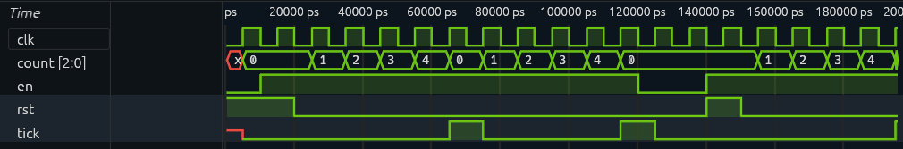

# Parameterized Tick Generator

**What it is:** A parameterized tick generator (`tick_gen`) that outputs a periodic single-cycle strobe pulse in Verilog.

**Why it matters:** Clean periodic tick strobes let downstream logic—such as debouncers, timers, LED blinkers, and control loops—run at a controlled rate within a single clock domain.

## Interface

| Port | Direction | Width | Description |
| :--- | :---: | :---: | :--- |
| `clk` | `input` | `1` | Clock input (active on rising edge) |
| `rst` | `input` | `1` | Synchronous active-high reset (clears counter and `tick` to `0`) |
| `en` | `input` | `1` | Enable input (allows counting and tick generation when high) |
| `tick` | `output` | `1` | Single-cycle tick pulse (`1` when count reaches target, `0` otherwise) |

## Design

- Parameterized divisor (`DIV`) and counter width (`WIDTH`) clocked on `posedge clk` using non-blocking assignments.
- When `rst` is high, internal count and `tick` clear to `0`; when `en` is high, the counter advances up to `DIV - 1`, pulses `tick` high for one cycle, and wraps back to `0`.

## Verification

- Lint-clean with `verilator --lint-only -Wall` (`make lint`).
- Self-checking testbench (`make test`) verifying reset, exact tick period, enable gating, and mid-run synchronous reset.

## Results

- Prints `TEST PASSED` with 0 errors.

## Limitations and next steps

- Fixed single-cycle pulse width once per `DIV` enabled clock cycles; no dynamic runtime divisor reload.
- Next: save `docs/waveform.png`, run `make clean`, confirm CI passes across all `SUBDIRS`, and build `debouncer` or `pwm`.