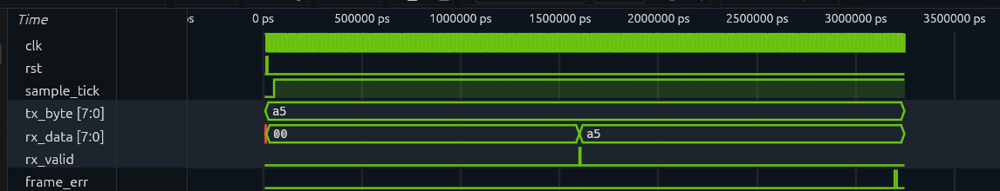

# 8N1 UART Receiver

**What it is:** A parameterized 8N1 UART receiver (`uart_rx`) using 2-FF input synchronization and `OS_FACTOR` oversampling in Verilog.

**Why it matters:** Pairing a receiver with `uart_tx` completes full-duplex asynchronous serial communication and demonstrates midpoint sampling and framing-error detection.

## Interface

| Port | Direction | Width | Description |
| :--- | :---: | :---: | :--- |
| `clk` | `input` | `1` | System clock input (active on rising edge) |
| `rst` | `input` | `1` | Synchronous active-high reset |
| `sample_tick` | `input` | `1` | Oversampling strobe (`OS_FACTOR` ticks per bit period) |
| `rx` | `input` | `1` | Asynchronous serial input line (idle high `1`) |
| `rx_data` | `output` | `DATA_BITS` | Received parallel word (LSB first) |
| `rx_valid` | `output` | `1` | Single-cycle pulse (`1`) when a valid frame completes |
| `frame_err` | `output` | `1` | High (`1`) if the stop bit is sampled low (`0`) |

## Design

- Synchronizes `rx` through two flip-flops (`rx_sync_0`, `rx_sync_1`) before FSM and shift logic.
- Confirms the start bit at half the oversampling count, samples data bits LSB-first at bit centers, and verifies the stop bit.

## Verification

- Lint-clean with `verilator --lint-only -Wall` (`make lint`).
- Self-checking testbench (`make test`) verifying reset, valid 8N1 frame reception (`8'hA5`), and stop-bit framing error detection.

## Results

- Prints `TEST PASSED` with 0 errors.

## Limitations and next steps

- Fixed 8N1-style framing (no parity bit or FIFO); assumes `sample_tick` rate matches the sender's baud rate.
- Next: save `docs/waveform.png`, run `make clean`, add `uart_rx` to root `Makefile` `SUBDIRS`, and build `i2c_master`.