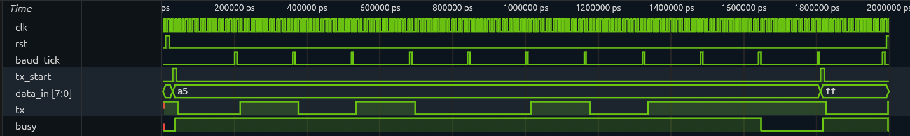

# 8N1 UART Transmitter

**What it is:** A parameterized 8N1 UART transmitter (`uart_tx`) driven by an external `baud_tick` strobe in Verilog.

**Why it matters:** Serial UART framing is a staple interface for debugging, telemetry, and microcontroller/FPGA board-to-board communication.

## Interface

| Port | Direction | Width | Description |
| :--- | :---: | :---: | :--- |
| `clk` | `input` | `1` | Clock input (active on rising edge) |
| `rst` | `input` | `1` | Synchronous active-high reset (`tx` returns high `1`, `busy` low `0`) |
| `baud_tick` | `input` | `1` | Bit-rate strobe advancing start, data, and stop states |
| `tx_start` | `input` | `1` | Starts transmitting `data_in` when idle |
| `data_in` | `input` | `DATA_BITS` | Parallel byte to serialize (LSB first) |
| `tx` | `output` | `1` | Serial output line (idle high `1`, start low `0`, stop high `1`) |
| `busy` | `output` | `1` | High (`1`) while a frame is being transmitted |

## Design

- Four-state synchronous FSM (`IDLE`, `START`, `DATA`, `STOP`) clocked on `posedge clk` using non-blocking assignments.
- Latches `data_in` on `tx_start` in `IDLE` and shifts out `DATA_BITS` LSB-first on each `baud_tick` pulse.

## Verification

- Lint-clean with `verilator --lint-only -Wall` (`make lint`).
- Self-checking testbench (`make test`) verifying reset, full 8N1 frame serialization (`8'hA5`), idle recovery, and mid-frame reset.

## Results

- Prints `TEST PASSED` with 0 errors.

## Limitations and next steps

- Transmit-only 8N1 framing with external `baud_tick`; no receiver (`uart_rx`), parity generation, or FIFO buffering yet.
- Next: save `docs/waveform.png`, run `make clean`, add `uart_tx` to root `Makefile` `SUBDIRS`, and build the SPI module.